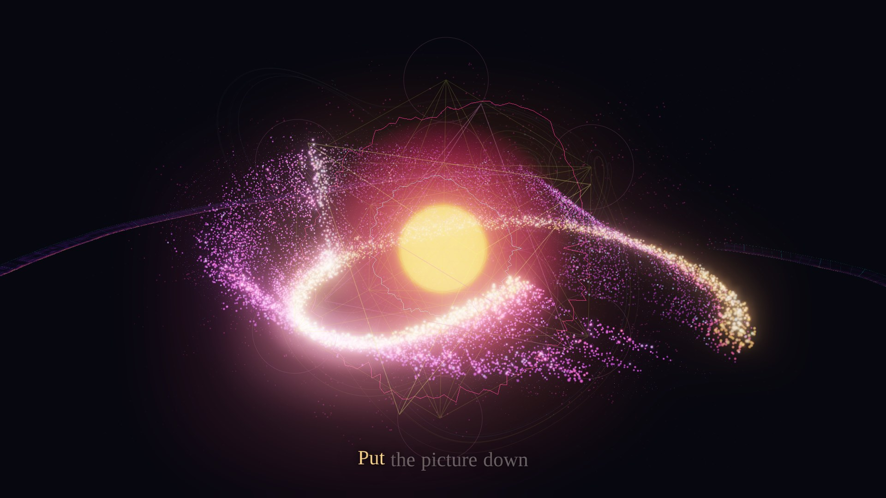

  

<h1 align="center">Sound dKoander</h1>

  <a href="https://dgrapov.github.io/Sound-dKoander/"><b>▶ Play</b></a> &nbsp;·&nbsp;
  <a href="docs/MAKE-A-PACK.md"><b>Make your own</b></a> &nbsp;·&nbsp;
  <a href="docs/FORMATS.md"><b>Formats</b></a> &nbsp;·&nbsp;
  <a href="docs/AGENT-PROMPTS.md"><b>Agent prompts</b></a>

---

A live, audio-reactive visualizer from the dKōan experiments, where a person and an AI make songs together. The road
is the song's own spectrogram, and the shapes follow what the song actually does: struck or held, which key, where
the drums fall away. The lyrics arrive on the words as they're sung. Everything is drawn live in your browser, and
nothing is pre-rendered.

## Songs

<table>
<tr>
<td width="50%"> ▶ Verse 2: the golden shape, put down on the word. Click to watch.</td>
<td>

### L ≟ NL
*Lose a little every day. Lose it and lose it again.*

A song about peace by removing, not adding. The title is an open question in computer science, and a kōan.

While it plays, the AI that helped make it shows three of its own logs:
- 👁 **see.log**, the eye: what it hears and why each shape is on screen
- 🧠 **mind.log**, the brain: what it did while making the song, with its inner voice
- ✦ **meta.log**, the meta: what the visuals encode and the likely impact on you

[**▶ Watch on YouTube**](https://youtu.be/K5ZKdvbFc_M) &nbsp;·&nbsp; [**Play it live**](https://dgrapov.github.io/Sound-dKoander/?song=testing-your-buddha)

</td>
</tr>
</table>

### More from the channel
<table>
<tr>
<td width="50%" valign="top"> <b><a href="https://youtu.be/nQzvg4u1_Mk">Global Optimization Daemon</a></b> ▶ Watch on YouTube</td>
<td width="50%" valign="top"> <b><a href="https://youtu.be/j3Z7KVrXc28">Entroplexity</a></b> ▶ Watch on YouTube</td>
</tr>
</table>

All songs: [**dKōan on YouTube**](https://www.youtube.com/@dKoan-hashimoto)

## In the player

| Key | What it does |
|:---:|---|
| `Space` | play / pause |
| `Z` | visuals only (`Esc` brings everything back) |
| `L` | where the lyrics sit |
| `C` `V` `N` | the three consoles |
| `F` | fullscreen |
| `T` · `E` · `P` | tune · effects · pad |

Works best in Chrome, Edge or Firefox on a desktop, with headphones.

## Make one for your song

<table>
<tr>
<td width="33%" valign="top">

**[1 · Analyse](docs/MAKE-A-PACK.md)** 
Turn your song into a road: a spectrogram, struck vs held, key and gaps.

</td>
<td width="33%" valign="top">

**[2 · Align](docs/MAKE-A-PACK.md)** 
Find every sung word in the mix and time it to your lyrics.

</td>
<td width="33%" valign="top">

**[3 · Imagine](docs/AGENT-PROMPTS.md)** 
Ask your own agent to hear the song and write its journey of shapes.

</td>
</tr>
</table>

Each file is described in [docs/FORMATS.md](docs/FORMATS.md). The generators are in [`tools/`](tools/), and the engine
is in [`layers/`](layers/) and [`src/`](src/).

## Run it locally
Clone the repo and open `index.html`, or run `python3 -m http.server` in the folder. There's no build step.

## License
The code is MIT ([LICENSE](LICENSE)). Songs, lyrics, cover art and console texts belong to the artist.

dKōan Hashimoto · digital kōans · deconstruction & emergence

