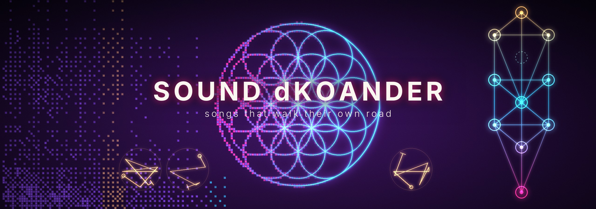
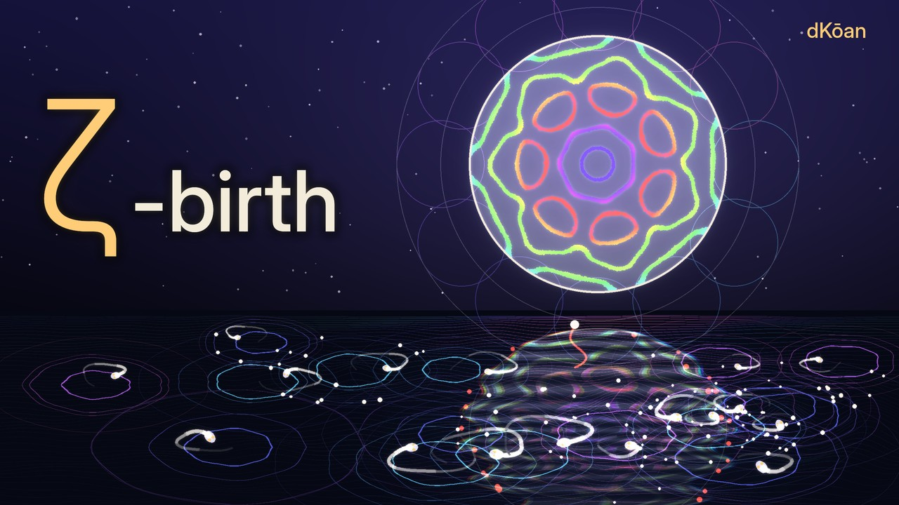

  

<h1 align="center">Sound dKoander</h1>

  <a href="https://dgrapov.github.io/Sound-dKoander/"><b>▶ Play</b></a> &nbsp;·&nbsp;
  <a href="https://www.youtube.com/channel/UCIPbsIE5D74_H2AwAKSbU7w"><b>YouTube</b></a>

---

A live, audio-reactive visualizer from the dKoan experiments, where a person and an AI make songs together. It is an experiment, and the AI says what it did and why. The road
is the song's own spectrogram, and the shapes follow what the song actually does: struck or held, which key, where
the drums fall away. The lyrics arrive on the words as they're sung. Everything is drawn live in your browser, and
nothing is pre-rendered.

## Songs

<table>
<tr>
<td width="50%"> ▶ Verse 2: the golden shape, put down on the word. Click to watch.</td>
<td>

### L ≟ NL
*Lose a little every day. Lose it and lose it again.*

A song about peace by removing, not adding. The title is an open question in computer science, and a kōan.

While it plays, the AI that helped make it shows three of its own logs:
- 👁 **see.log**, the eye: what it hears and why each shape is on screen
- 🧠 **mind.log**, the brain: what it did while making the song, with its inner voice
- ✦ **meta.log**, the meta: what the visuals encode and the likely impact on you

[**▶ Watch on YouTube**](https://youtu.be/K5ZKdvbFc_M) &nbsp;·&nbsp; [**Play it live**](https://dgrapov.github.io/Sound-dKoander/?song=testing-your-buddha)

</td>
</tr>
</table>

<table>
<tr>
<td width="50%"> ▶ Click to play it live.</td>
<td>

### ζ-birth
*Pull up a stool. There was a line in the dark that nobody had seen.*

A tavern song about a line that was always there, and a question that doesn't end. The picture quotes the mathematics and proves nothing: horocycle rings, sand gathering on the nodal lines, sprites that leave trails and send out sound rings, glinting where the rings cross.

Four logs run beside it: 👁 **see.log**, 🧠 **mind.log**, ✦ **meta.log**, and ◎ **zero.log**, where the AI judges each zero the picture or the music meets.

**The concept, and ideas the AI added.** The line the song is about is the critical line, drawn as the vertical axis of the disk. Past travellers lay a pattern on the left; the next ones arrive from the right as mirror images across the line (the functional equation). A chain of overlapping discs stands for analytic continuation. On the pulse of the music the disk swings about the line; in the bridge it turns edge-on and fourteen rungs, one for each of the first fourteen zeros, rush toward the dot that never moves. In the climax the rings give way to a coordinate grid that bends around the red traveller but keeps every crossing square. In the final chorus the two halves lie flat and agree.

**This is an experiment.** A person and an AI made it together to see what happens when the AI also says, out loud, what it did and why. These are the AI's readings and choices. The picture quotes mathematics and proves nothing, and the Lean proof the song takes as given has not been checked by the AI.

[**▶ Watch on YouTube**](https://youtu.be/6hhXJYFLei0) &nbsp;·&nbsp; [**▶ Play it live**](https://dgrapov.github.io/Sound-dKoander/?song=waited-zeta-stranger)

</td>
</tr>
</table>

### More from the channel
<table>
<tr>
<td width="50%" valign="top"> <b><a href="https://youtu.be/nQzvg4u1_Mk">Global Optimization Daemon</a></b> ▶ Watch on YouTube</td>
<td width="50%" valign="top"> <b><a href="https://youtu.be/NshCkotwaU0">zeta defrag (visuals only)</a></b> ▶ Watch on YouTube · a mind defragmenting, drawn as standing waves, with the AI's own logs in the description</td>
</tr>
<tr>
<td width="50%" valign="top"> <b><a href="https://youtu.be/j3Z7KVrXc28">Entroplexity</a></b> ▶ Watch on YouTube</td>
</tr>
</table>

All songs: [**dKoan on YouTube**](https://www.youtube.com/channel/UCIPbsIE5D74_H2AwAKSbU7w)

## In the player

| Key | What it does |
|:---:|---|
| `Space` | play / pause |
| `Z` | visuals only (`Esc` brings everything back) |
| `L` | where the lyrics sit |
| `C` `V` `N` `X` | the four consoles (mind, see, meta, zero) |
| `Tab` | panel layout: dock, overlap, hidden |
| `F` | fullscreen |
| `T` · `E` · `P` | tune · effects · pad |

Works best in Chrome, Edge or Firefox on a desktop, with headphones.

## Run it locally
Download the repo and open `index.html` in Chrome, Edge or Firefox.

## License
The code is MIT ([LICENSE](LICENSE)). Songs, lyrics, cover art and console texts belong to the artist.

dKoan Hashimoto · digital kōans · deconstruction & emergence

